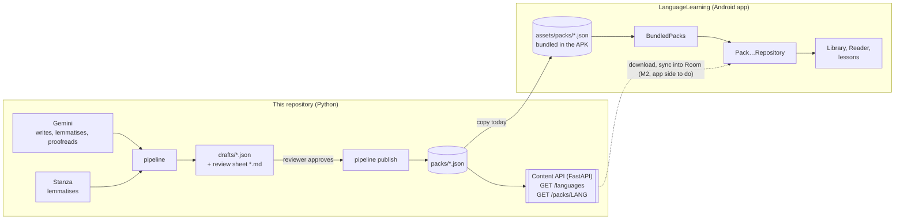
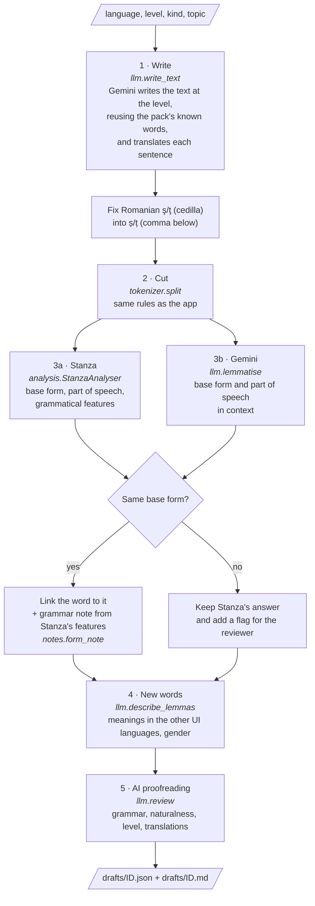
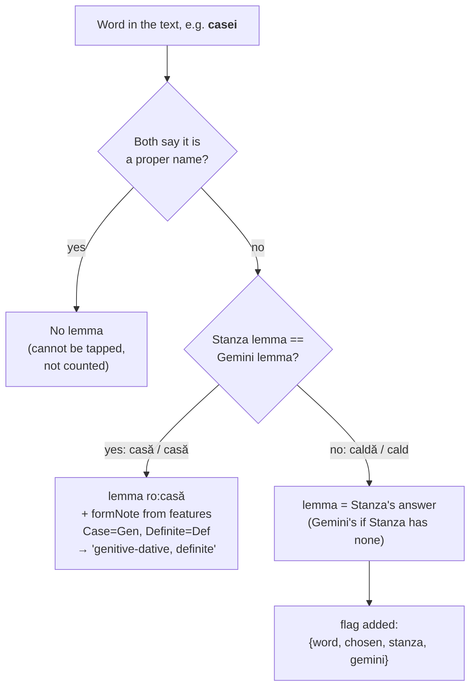
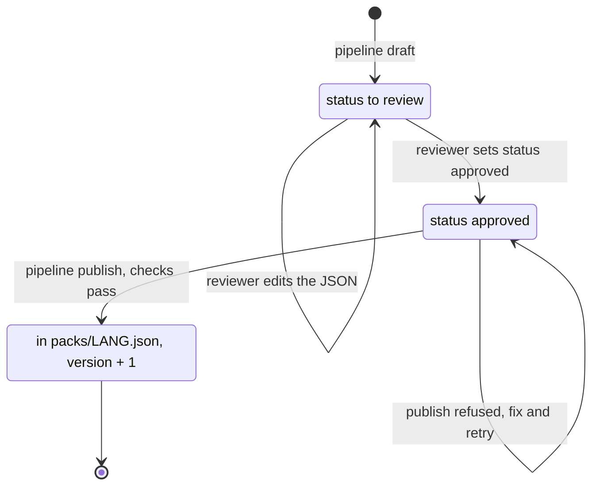
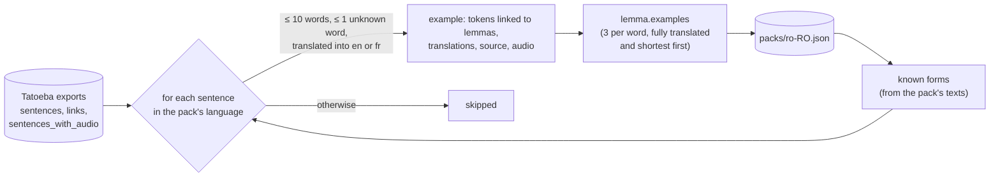
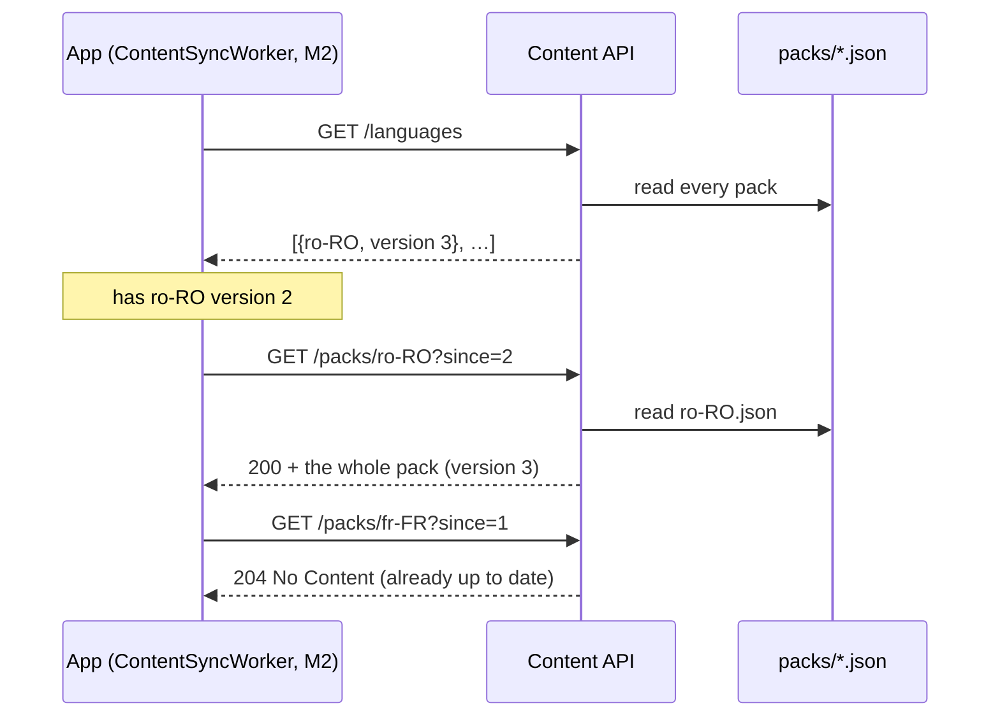
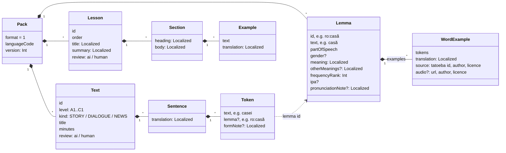
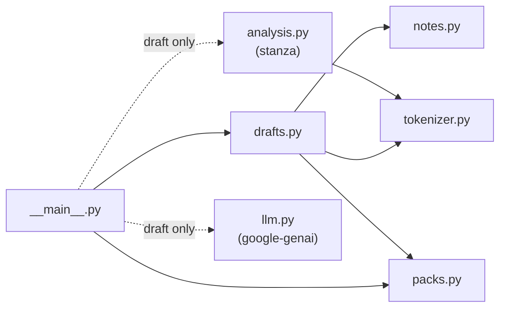

# LanguageLearning — Content Generation

This project produces the **language packs** read by the [LanguageLearning](https://github.com/Namularbre/LanguageLearning) Android app: graded reading texts, the words they use, and the "How the language works" lessons. There is one JSON file per language (`packs/ro-RO.json`, `packs/en-GB.json`, `packs/fr-FR.json`).

The app only **reads** content. It never writes texts and never guesses the base form of a word: Romanian cases and articles change word endings (*casă, casa, casei, casele*), and an on-device lemmatiser is not reliable enough. This project does that work once per text, with AI help, and a review step checks it before publication.

- [Where this project fits](#where-this-project-fits)
- [Quick start](#quick-start)
- [The pipeline, step by step](#the-pipeline-step-by-step)
- [Choosing the base form of a word](#choosing-the-base-form-of-a-word)
- [Life of a draft](#life-of-a-draft)
- [Reviewing a draft](#reviewing-a-draft)
- [Real example sentences (Tatoeba)](#real-example-sentences-tatoeba)
- [Content API](#content-api)
- [Pack format](#pack-format)
- [Checks](#checks)
- [Code layout](#code-layout)
- [Design choices and limits](#design-choices-and-limits)
- [Troubleshooting](#troubleshooting)

---

## Where this project fits



- **Today**: published packs are copied into the app (`core/data/src/main/assets/packs/`) and shipped in the APK.
- **M2**: the same files are served by the [content API](#content-api) (`GET /packs/{languageCode}`); the app still has to download them and store them in Room. The bundled packs remain as first-launch content, so the app still works offline.

---

## Quick start

The project is managed with [uv](https://docs.astral.sh/uv/) (`pyproject.toml`, `uv.lock`). Install uv once: `curl -LsSf https://astral.sh/uv/install.sh | sh` (or `brew install uv`, `pipx install uv`).

```bash
# Checks and tests: no extra dependency, no network
uv run --extra api python -m unittest discover -s tests -t .   # without --extra api, the API tests are skipped
uv run pipeline check

# Writing drafts: the `draft` extra (Stanza pulls PyTorch, about 500 MB to 1 GB) and a Gemini API key
export GEMINI_API_KEY=...                # https://aistudio.google.com/apikey, never commit it

uv run --extra draft pipeline draft --language ro-RO --id ro-bakery --level A1 \
    --kind STORY --topic "buying bread at the bakery"
#   -> drafts/ro-bakery.json and drafts/ro-bakery.md

# ... review the draft, set "status": "approved" ...

uv run pipeline publish drafts/ro-bakery.json
#   -> packs/ro-RO.json, version + 1

cp packs/*.json ../LanguageLearning/core/data/src/main/assets/packs/
```

`uv run` creates `.venv/` on first use, with the Python version of `.python-version` (3.12) and the versions locked in `uv.lock`. Only `draft` needs `--extra draft`; the other commands run without Stanza and Gemini installed.

| Command | What it does |
|---|---|
| `uv run --extra draft pipeline draft --language L --id ID --level A1..C1 [--kind STORY\|DIALOGUE\|NEWS] --topic "..." [--sentences 8]` | Writes a new text with Gemini, annotates it, saves a draft and its review sheet |
| `uv run pipeline publish DRAFT.json [...]` | Adds approved drafts to their pack and raises its version; refuses if a check fails |
| `uv run pipeline examples --language L [--per-word 3] [--max-words 10] [--max-unknown 1]` | Adds real example sentences from Tatoeba to the words of a pack |
| `uv run pipeline check [PACK.json ...]` | Runs the pack checks (all packs by default) |
| `uv run pipeline format [PACK.json ...]` | Rewrites packs in the stable layout |

The first `draft` for a language downloads its Stanza model (a few hundred MB). The Gemini model is `gemini-flash-latest` by default; set `GEMINI_MODEL` to pin another one.

---

## The pipeline, step by step



1. **Write.** Gemini writes a story, dialogue or news item at the requested CEFR level. The prompt lists the words the pack already has (most frequent first) so the text stays at about 90% known words, and asks for a translation of every sentence into the other UI languages (English, French, Romanian, minus the text's own language).
2. **Cut.** `tokenizer.py` cuts each sentence into words and the text between them, with **exactly the rules of the app's `Tokenizer`**: a French elision gives two words (*l'homme* → *l'* + *homme*), and a hyphen separates words (*într-o* → *într* + *o*). A test checks that it cuts every published sentence the same way as the app.
3. **Base forms, two opinions.** Stanza and Gemini each give the base form of every word. See [Choosing the base form of a word](#choosing-the-base-form-of-a-word).
4. **New words.** Words the pack does not know yet get a dictionary entry: meaning in the other UI languages and gender for nouns.
5. **AI proofreading.** A second Gemini call, acting as a strict proofreader, lists problems with grammar, naturalness, level and translations. It only reports problems and does not rewrite the text.

The result is a **draft**. Nothing reaches a pack until a reviewer approves it.

---

## Choosing the base form of a word

Each word in a text is linked to its base form (its *lemma*). That link drives the whole app: word status, review cards and comprehension are tracked per base form, so *casei* and *casa* count as the same word *casă*.



- **Stanza** ([stanfordnlp.github.io/stanza](https://stanfordnlp.github.io/stanza/)) is a Stanford library trained on annotated corpora (Universal Dependencies). It handles Romanian, French and English, and it also returns grammatical features such as case, number, definiteness and tense.
- **Gemini** reads the word in context, which helps with ambiguous forms.
- Base forms are written the way the packs write them: Romanian verbs take *a* (*a merge*), French verbs are infinitives (*aller*), English verbs are bare (*go*). `drafts.stanza_base_form` adapts Stanza's output to these conventions.
- **Grammar notes** come from a fixed table (`notes.py`), not from the AI, so the same form always gets the same note in English, French and Romanian.

When the two opinions agree, the word is very likely right. When they disagree, a person looks at it. This keeps the review short: the reviewer reads the flags, not every word.

---

## Life of a draft



A draft (`drafts/<id>.json`) holds:

```jsonc
{
  "languageCode": "ro-RO",
  "status": "to review",          // the reviewer sets "approved"
  "reviewedBy": "ai",             // the reviewer sets "human" only if fluent in the language
  "text": { /* the text in pack format, see below */ },
  "newLemmas": [ /* dictionary entries for words the pack does not know */ ],
  "flags": [
    {"sentence": 1, "word": "caldă", "chosen": "ro:caldă", "stanza": "caldă", "gemini": "cald"}
  ],
  "aiReview": [
    {"sentence": 1, "where": "text", "problem": "…", "suggestion": "…"}
  ]
}
```

When a draft is published, its new words are added to the pack after the existing ones (`frequencyRank` = last + 1), its text is added (or replaces a text with the same id), the pack's `version` goes up by one, and the whole pack is checked. If any check fails, nothing is saved.

---

## Reviewing a draft

Open `drafts/<id>.md`. It lists the text, its translations, the flagged words, the AI proofreader's remarks and the new words.

1. **Flagged words**: in `drafts/<id>.json`, find the token in `text.sentences[N].tokens` and set its `lemma` to the right base form (e.g. `"ro:cald"`). If the new base form is not in the pack, add or fix its entry in `newLemmas`.
2. **AI remarks**: fix the sentence or translation if the remark is right. When you change a sentence's words, run `draft` again rather than editing tokens by hand, so the cutting and the lemmas stay consistent.
3. **New words**: check the meanings and the gender.
4. Set `"status": "approved"`. Set `"reviewedBy": "human"` only if you are fluent in the text's language.
5. Run `uv run pipeline publish drafts/<id>.json`.

### Who reviews what

No native Romanian speaker is available yet, so every text and lesson in a pack carries a `review` field:

| Value | Meaning |
|---|---|
| `"ai"` | Checked by the two AI opinions, the AI proofreader and the automatic checks. Not read by a fluent person. |
| `"human"` | Read and approved by a person fluent in the language. |

French content can be reviewed by the author. Romanian content stays `"ai"` until a native speaker (a tutor or a student) reads it, and the field shows exactly what is left to read. The app ignores this field for now.

---

## Real example sentences (Tatoeba)

Stories are generated, but **example sentences** for the words come from [Tatoeba](https://tatoeba.org): short sentences written and translated by people, many in Romanian, French and English, some with a recording. They feed the word sheet, the multiple-choice questions and the review cards with real sentences instead of invented ones.

```bash
uv run pipeline examples --language ro-RO       # first run downloads the exports into .cache/ (a few hundred MB)
```



- A word of the sentence is linked to its base form through the **forms already seen in the pack's texts** (*casei* → *casă*). A form seen with two different base forms is not used, so no lemma is guessed. Names the texts use (Ana, Mihai) count as readable.
- Running it again replaces the examples and raises the pack version only if something changed.
- Romanian sentences written with a cedilla (ş, ţ) are corrected to the comma below.

### Licence and credits (the app must show them)

| What | Licence | What to show |
|---|---|---|
| Sentences and translations | CC BY 2.0 FR | "Example sentences from Tatoeba (https://tatoeba.org), CC BY 2.0 FR", e.g. in a Credits screen |
| Recordings | chosen by each person (CC BY, CC BY-NC…) | the author and licence of each recording used (`audio.author`, `audio.license`) |

Recordings without a licence may not be reused outside Tatoeba, so they are never kept. Each example keeps its Tatoeba sentence id and author (`source`), which is what a Credits screen needs. Note that some recordings are **non-commercial** (CC BY-NC): if the app is ever sold, filter them out.

---

## Content API

A [FastAPI](https://fastapi.tiangolo.com/) app (`api/main.py`) that serves the files of `packs/` read-only. It is deliberately minimal: no database, no authentication, the files are read at each request, so a `pipeline publish` is served at once.

```bash
uv run --extra api fastapi dev api/main.py      # development, reloads on change
uv run --extra api fastapi run api/main.py      # production-like, port 8000
# interactive documentation: http://127.0.0.1:8000/docs
```

| Method | Route | Answer |
|---|---|---|
| GET | `/languages` | `[{"languageCode": "ro-RO", "version": 3}, …]`: every pack and its content version |
| GET | `/packs/{languageCode}` | the whole pack (same JSON as the file); `404` if there is none |
| GET | `/packs/{languageCode}?since=3` | `204 No Content` if the pack's version is 3 or less (the app is up to date), else the whole pack |



The language code in the URL is only matched against the existing file names, so a request cannot read any other file.

---

## Pack format

Format version **1**, read by the app's `ContentPackParser`. The full explanation is in the app's [`docs/understanding/content-packs.md`](https://github.com/Namularbre/LanguageLearning/blob/m1-prototype/docs/understanding/content-packs.md).



- `Localized` is an object keyed by UI language: `{"en": "house", "fr": "maison"}`. Content in a language is translated into the **other** UI languages; notes and lesson texts exist in all three.
- A sentence is a list of **tokens**. Joining their `text` gives the sentence back. Words carry a `lemma`; spaces, punctuation and proper names do not.
- Unknown keys are ignored by the app, so optional fields (like `review`) can be added without breaking it. A change the app cannot read must raise `format`.

Packs are written in a stable layout (`uv run pipeline format`): an object that fits on one line stays on one line, so a change shows up as a one-line diff.

---

## Checks

`uv run pipeline check` runs the same checks as the app's `PackContentTest`. CI runs them on every pull request.

| Check | Why |
|---|---|
| `format` is 1 | the app refuses other formats |
| Unique text, lemma and lesson ids; unique frequency ranks | the app finds content by id; the level test orders words by rank |
| Every word token points to a lemma of the pack | a tap on a word must open its sheet |
| Every lemma is used by a text | no orphan words in the level test |
| Translations present in exactly the other UI languages; notes in all three | the app shows the learner's UI language |
| Romanian ș/ț with a comma below, never a cedilla (ş/ţ) | the cedilla forms are wrong in Romanian |
| Every text has at least one word | comprehension is computed on words |
| Every example uses its word, has a translation, and credits its source (and its recording's author and licence) | Tatoeba's licence requires credit |

---

## Code layout

```
pipeline/
  __main__.py   command line (draft, publish, check, format)
  tokenizer.py  cutting sentences into words, like the app's Tokenizer
  analysis.py   Stanza: base form, part of speech, features; matched to the app's words by position
  llm.py        every Gemini prompt (write, lemmatise, describe words, proofread) + FakeLlm for tests
  notes.py      grammar notes from Universal Dependencies features, in English, French and Romanian
  drafts.py     building a draft, the review sheet, publishing into a pack
  packs.py      loading, checking, formatting packs
  tatoeba.py    example sentences from Tatoeba: download, selection, credits
api/
  main.py       content API (FastAPI): /languages, /packs/{languageCode}
packs/          published packs: the source of truth for the app's bundled packs
drafts/         drafts waiting for review
tests/          unit tests (fake AI and fake Stanza: no network, no dependency)
```



Stanza and `google-genai` are imported only by the `draft` command, FastAPI only by `api/`. The rest needs only the standard library: dependencies live in the optional `draft` and `api` extras of `pyproject.toml`. The API tests are skipped when the `api` extra is not installed.

---

## Design choices and limits

- **Two opinions on base forms instead of one.** Stanza is reliable on common forms but trips on ambiguous ones; the AI understands context but can invent forms. Their disagreement is a cheap signal of where a person must look.
- **Grammar notes from a table instead of from the AI.** Identical forms get identical notes, and the table is reviewed once.
- **A separate repository.** The Android app only holds the packs, not the tooling that produces them.
- **New words are ranked after the known ones.** `frequencyRank` orders the level test, so an approximate order is acceptable for now. A frequency list could replace it later.
- **Lessons are not generated yet.** They are written by hand in the packs. Only reading texts go through the pipeline.
- **Tested on the real services once.** A Romanian A1 draft ran end to end on Windows with Stanza 1.15 and Gemini; the rest of the logic is covered by tests with fakes.

---

## Troubleshooting

| Problem | What to do |
|---|---|
| Error about a missing API key, or an authentication error | `export GEMINI_API_KEY=...` (key from [Google AI Studio](https://aistudio.google.com/apikey)) |
| Model not found | Set `GEMINI_MODEL` to a current model name from the [Gemini model list](https://ai.google.dev/gemini-api/docs/models) |
| Stanza download fails | It downloads from huggingface.co: check your network or proxy, then run `draft` again |
| `publish` says "not approved" | Set `"status": "approved"` in the draft |
| `publish` lists problems | Fix them in the draft (usually a lemma missing from `newLemmas`), then publish again |
